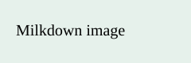

# Markdown 全语法实测

## 本轮重点：HTML、代码、表格和图片

正文标签：<mark>HTML 荧光高亮</mark>，<kbd>Ctrl</kbd> + <kbd>S</kbd>，H<sub>2</sub>O，x<sup>2</sup>。

<div><strong>HTML 正文块</strong><p>这里直接渲染标签；点击可修改原始标签，按 Esc 回到正文。</p></div>

代码块只显示源码和语言，不生成 HTML 预览。点击左上角语言名可切换语言。

```html
<section>
  <h3>这是 HTML 源码</h3>
  <p>正文 <mark>重点</mark></p>
</section>
```

```javascript
const count = 3;
function square(x) {
  return x * x; // 保留代码缩进
}
```

表格：悬停单元格，点击上方或左侧的小手柄，打开对齐/删除工具栏；移动到行列边界可点击加号插入。

| 方法 | 结果 |
| --- | ---: |
| Self-RAG | 42 |
| CRAG | 35 |

图片：悬停后拖动下沿手柄，可按比例放大或缩小；在 75% 缩放下也可以拖动。



## 新增功能快速检查

==荧光高亮== 与 **加粗**，H~2~O 与 x^2^，~~删除线~~。

[[双链目标笔记]] · [[双链目标笔记|别名链接]]

[TOC]


这是一份可直接编辑的验收笔记。覆盖 CommonMark 基础、GFM 表格与任务列表、Milkdown 数学扩展；最后单独列出扩展兼容性探针。每项检查渲染、编辑、保存重载三种行为。

## 01 标题与段落

### 三级标题
#### 四级标题
##### 五级标题
###### 六级标题

Setext 一级标题
=================

Setext 二级标题
-----------------

这是独立段落。中文、English、数字 2026 和标点（括号）应正常排版。

这一行使用软换行，
续行应仍属于同一段落。

这里使用两个空格硬换行。  
这里是下一行。

这里使用反斜杠硬换行。\
这里也是下一行。

## 02 行内格式与转义

**星号加粗**、__下划线加粗__、*星号斜体*、_下划线斜体_、***粗斜体***、~~删除线~~。

**加粗包含 *斜体* 和 `code`**，`行内代码 <tag> & *literal*`，``包含 `反引号` 的代码``。

转义应显示字面符号：\*不是斜体\*、\#不是标题、\[不是链接\]、\_下划线\_、\\反斜杠。

实体：&amp; &lt; &gt; &quot; &#169; &#x1F600;。

## 03 列表与任务

- 无序第一项
- 无序第二项：这是一段较长的文字，用于检查窄卡片中的折行、圆点对齐以及多行缩进，所有行都应保持可读。
  - 第二层项目
    - 第三层项目
  - 返回第二层
- 返回第一层

3. 从三开始的有序列表
4. 第二个有序项目
   1. 嵌套有序项目
   2. 嵌套项目包含 **加粗**

- 混合嵌套
  1. 有序子项
  2. 有序子项二

- [ ] 待办：点击复选框检查状态
- [x] 已完成：再次点击应取消勾选
  - [ ] 嵌套待办

- 宽松列表第一项，下面仍是本项第二段。

  本项第二段文字。

- 宽松列表第二项。

## 04 引用与分隔线

> 普通引用第一段。
>
> 引用第二段，含 **重点** 和 $E=mc^2$。
>
> > 嵌套引用。
>
> - 引用内的列表
> - 第二项

下面依次是三种分隔线。

---

***

___

## 05 链接

[行内链接](https://milkdown.dev "Milkdown 官方网站")、[引用式链接][milkdown]、[快捷引用]。

自动链接：<https://example.com>，裸网址：https://example.com/path，邮箱：<reader@example.com>。

[milkdown]: https://milkdown.dev "引用式标题"
[快捷引用]: https://example.com

## 06 表格

| 左对齐 | 居中 | 右对齐 |
| :--- | :---: | ---: |
| **重点** | *解释* | 123.45 |
| `code` | [链接](https://example.com) | -9 |
| 转义竖线 a\|b | 多字说明，检查窄卡片换行 | 10000 |

## 07 代码

```javascript
const text = "<tag> & **not bold**";
function square(x) {
  return x * x;
}
```

~~~text
波浪线围栏内的 # 标题、*斜体* 不应被格式化。
~~~

    四空格缩进代码
    第二行保持缩进。

````markdown
```js
// 代码围栏可以作为代码展示
```
````

## 08 数学公式

行内：$x^2+y^2=z^2$；分数：$\frac{a+b}{c}$；希腊字母：$\alpha+\beta=\gamma$。

$$
\sum_{i=1}^{n} x_i = \int_0^1 f(x)\,dx
$$

$$
\begin{aligned}
f(x)&=x^2+2x+1\\
&=(x+1)^2
\end{aligned}
$$

$$
\begin{pmatrix}1&2\\3&4\end{pmatrix}
$$

普通价格与转义：\$25、\$100，不应触发公式。

公式后输入检查：光标离开公式后，正文和斜杠菜单应能继续使用。

## 09 图片


图片必须保持原比例；上面的图片宽高比为 3:1。

## 10 长文、混排与窄卡片

中文研究说明 **核心结论** 与 English terms、数字 123456、公式 $p(y\mid x)$ 混排，不应发生文字重叠。调整 300 / 420 / 720 像素宽度后，段落重新排版，插入块加号始终留在卡片左侧内侧。

长字符串：abcdefghijklmnopqrstuvwxyzABCDEFGHIJKLMNOPQRSTUVWXYZ0123456789abcdefghijklmnopqrstuvwxyzABCDEFGHIJKLMNOPQRSTUVWXYZ0123456789。

## 11 扩展语法

高亮、上下标、双链、独立目录及 Mermaid 是本轮新增实测项目。

脚注引用[^note]。

[^note]: 脚注内容。

==高亮扩展==、==含 **加粗** 的重点==、H~2~O、X^2^；~~删除线仍然正常~~。

转义 \==不高亮\==，代码 `==不高亮== H~2~O [[不跳转]]`。

以下保留为普通文本：`:smile:`和定义列表。

[[双链目标笔记]]、[[双链目标笔记|使用别名打开]]。

[TOC]

行内的 `[TOC]` 不生成目录，独立一行的目录才生成。


## 12 交互验收步骤

1. 在空段落和已有文字后输入 `/`，分别插入标题、列表、引用、分隔线、表格、图片、行内公式和公式块。
2. 使用 `$...$`、`$$...$$` 和 `$$` 后回车输入公式。退出后继续输入正文和 `/`。
3. 选中文字，检查选中颜色与浮动工具栏；执行加粗并撤销、重做。
4. 点击任务复选框，编辑表格单元格，按 Tab 跳到下一格。
5. 点击“保存后重载”，确认内容与任务状态保留。
6. 在不同宽度、缩放和卡片内滚动模式下，检查左侧加号是否在卡片内，点击加号能否插入。

实测终点。
